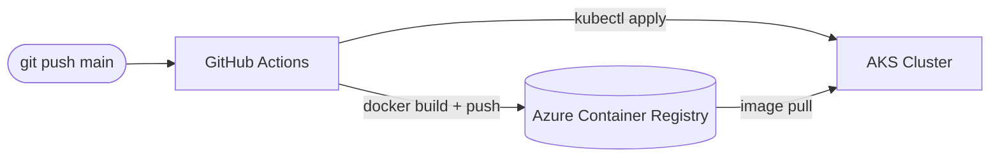

# Azure CI/CD to AKS with GitHub Actions (Terraform)

> Terraform provisions ACR + AKS; a GitHub Actions pipeline builds the image, pushes to ACR, and deploys to AKS on every push to `main`.
> **Author:** Muhammad Ahmad · **IaC:** Terraform · **Cloud:** Azure


---

## 📌 Overview

- **Terraform** builds the platform: **ACR** + **AKS** with an AcrPull role assignment.
- **GitHub Actions** (`.github/workflows/deploy.yml`) runs the pipeline: Azure login → build image → push to ACR → set AKS context → `kubectl apply`.
- **Kubernetes manifests** (`k8s/`) define a 2-replica Deployment and a LoadBalancer Service.

## 🏗️ Architecture

> 🎨 **Interactive diagram (industry-standard icons):** [open in Lucid — page 16](https://lucid.app/lucidchart/3da75ce3-ea66-4296-81b3-00d20a60435b/edit)



## 🚀 Setup

1. `terraform apply` to create ACR + AKS.
2. Add GitHub repo **secrets**: `AZURE_CREDENTIALS` (service principal JSON), `ACR_NAME`, `AKS_RESOURCE_GROUP`, `AKS_CLUSTER` (from Terraform outputs).
3. Push to `main` — the pipeline builds and deploys automatically.

## 🧹 Clean up

```bash
cd terraform && terraform destroy
```

## 🔐 Production hardening (next steps)

- Use **OIDC federated credentials** instead of a long-lived `AZURE_CREDENTIALS` secret.
- Add a **staging** environment and manual approval gate.
- Add **Helm** and image vulnerability scanning in the pipeline.

---

*Built and maintained by **Muhammad Ahmad**.*
