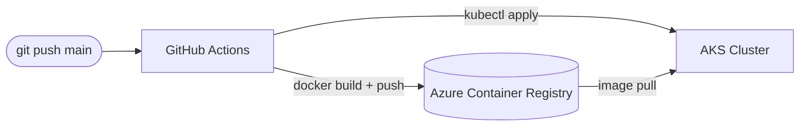

# Architecture Diagram — Azure CI/CD to AKS

## Lucid diagram

- **View:** https://lucid.app/lucidchart/d7d738ff-e52a-4a84-b030-12cab7d5c8f2/view
- **Edit:** https://lucid.app/lucidchart/d7d738ff-e52a-4a84-b030-12cab7d5c8f2/edit

## Lucid prompt (reusable)

```
Create an Azure CI/CD diagram titled "Azure CI/CD to AKS with GitHub Actions".
A git push to main triggers GitHub Actions. GitHub Actions does docker build and push
to Azure Container Registry (ACR), then runs kubectl apply to deploy to an AKS cluster;
AKS pulls the image from ACR. Label the arrows. Clean, professional colors.
```

## Mermaid source


